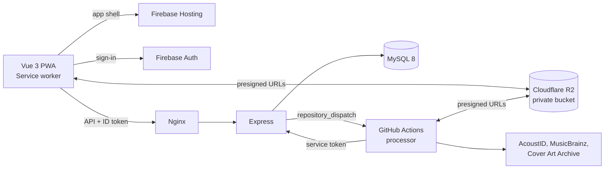

# Audify

A private music streaming PWA for a family: one shared music pool, personal playlists, offline listening in the car, and uploads approved by an admin. Non-commercial. It runs on about $4.80 a month.


## Architecture



**The droplet never touches audio.** It has 512 MiB of memory, so audio goes directly between the browser and R2 through short-lived presigned URLs. Express only checks who you are and signs the link.

## Design decisions

| Decision | Why |
|---|---|
| Transcoding on GitHub Actions | A free, disposable machine with ffmpeg. The droplet could not do this. The processor holds no storage credentials: it gets presigned URLs from the API. |
| Opus at 96 kbps, AAC as a fallback | Small on mobile data. The app picks by feature detection, never by device name. |
| FLAC only from lossless sources | A FLAC upload streams as itself. ALAC and WAV get a FLAC copy. Lossy files never become FLAC. |
| Offline copies last 5 days | Each song has its own timer. Playing doesn't extend it, and renewing costs no data. |
| Offline state lives on the device | The server stores nothing about what a phone has saved. The phone asks which of its songs are no longer allowed. |
| R2 keys use the upload's UUID | The processor needs storage URLs before the track row exists. |
| Deletes go through a queue | Database changes commit in a transaction, and R2 deletes retry from `r2_cleanup_queue` with growing delays. |
| The server checks hashes | The processor can't decide what counts as a duplicate, so the rule lives in one place. |

## Schema

`db/schema.sql` is the base 3NF schema. `db/patches/` apply on top, in order. The main tables are `tracks`, `track_files` (every stored version), `artists`, `albums`, `playlists`, `play_history` and `uploads`. Users, artists, albums, tracks and genres can be archived or soft-deleted. `tracks.published_at` stays empty until the admin approves a song.

## Repository layout

```
frontend/    Vue 3 PWA (service worker in src/sw.js)
backend/     Express API, background jobs
processor/   Upload pipeline, run by GitHub Actions
db/          Schema and patches
infra/       Droplet setup, Nginx, MySQL, cron, R2 CORS
.github/     Processor and CI workflows
```

## Run it locally

You need Node 22 and MySQL 8, with these settings in your MySQL config. Search depends on them:

```ini
innodb_ft_min_token_size = 1
innodb_ft_enable_stopword = OFF
default-time-zone = '+00:00'
```

```bash
mysql -uroot < db/schema.sql
for n in 1 2 3; do mysql -uroot < db/patches/patch_$n.sql; done

cd backend && cp .env.development.example .env.development && npm install && npm run dev
cd frontend && cp .env.development.example .env.development && npm install && npm run dev
```

Development mode replaces Google sign-in with a typed email, and R2 with local files in `backend/.dev-storage`. The server refuses this mode when `NODE_ENV=production`.

Or start both from the project root:

```bash
npm run dev       # this machine only
npm run dev:lan   # also reachable from other devices on your network
```

`dev:lan` prints the address to open on your phone. Use it on a network you trust: with development sign-in, anyone who can reach it can sign in as any email, including the admin. Over plain `http://` on a network, browsers remove the features behind saving offline, so that part only works on `localhost` or the live HTTPS site. If the phone can't connect, allow Node through Windows Firewall for private networks, and check your VPN isn't blocking local devices. If the wrong address is picked, set `LAN_IP` in `backend/.env.development`.

To process uploads locally, install ffmpeg, keep `npm run dev` running, and run this from the project root after each upload:

```bash
npm run process
```

To use Autocomplete in Edit labels, set `MUSICBRAINZ_CONTACT` to your email in `backend/.env.development`.

## Running the tests

```bash
cd backend && TEST_DB_PORT=3306 npm test    # needs MySQL; it creates and drops audify_test
cd processor && npm test
cd frontend && npm test && npm run build
```

## Going live

1. **Accounts.** Create a Firebase project with Google and Email/Password sign-in, an R2 bucket and a backups bucket, a $4 droplet with backups on, and an AcoustID API key.
2. **Droplet.** Clone to `/opt/audify` and run `sudo ADMIN_USER=<you> bash infra/setup-droplet.sh`.
3. **Database.** Load `db/schema.sql`, then the patches, and create an `audify` MySQL user for that database only.
4. **Certificate.** Staging first, then again without `--staging`:
   ```bash
   sudo certbot certonly --staging --preferred-profile shortlived \
     --webroot --webroot-path /var/www/acme --ip-address <droplet-ip> \
     --deploy-hook "systemctl reload nginx"
   ```
   Then install `infra/nginx/audify-https.conf` with your IP filled in, and reload Nginx.
5. **API.** Fill in `/etc/audify/backend.env` from `backend/.env.example` (`chmod 600`), run `npm ci --omit=dev` in `backend/`, then `pm2 start infra/ecosystem.config.cjs`, `pm2 save` and `pm2 startup`.
6. **R2.** Apply `infra/r2/cors.json` with your origin, leave `r2.dev` disabled, and add a 7-day lifecycle rule to the backups bucket.
7. **Firebase.** Set `authDomain` to `<project>.web.app`, and add `https://<project>.web.app/__/auth/handler` to the Google OAuth client's redirect URIs. Build with `frontend/.env.production`, then `firebase deploy --only hosting`.
8. **GitHub.** Add the secrets `API_BASE_URL`, `PROCESSOR_SERVICE_TOKEN`, `ACOUSTID_API_KEY` and `MUSICBRAINZ_CONTACT`.
9. **Cron.** Install `infra/cron/backup.sh` and `infra/cron/cert-check.sh`, and test one restore into a local MySQL.
10. **First sign-in.** Sign in with `ADMIN_BOOTSTRAP_EMAIL` to become admin. Test on a real iPhone, in Safari and from the Home Screen.

**Never put music files in this repo.** Actions logs are public, so the processor logs upload IDs only.
